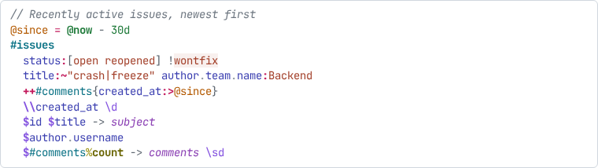
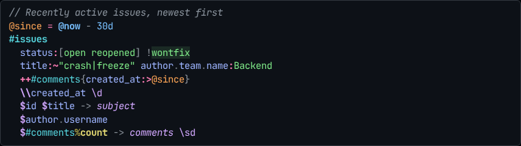
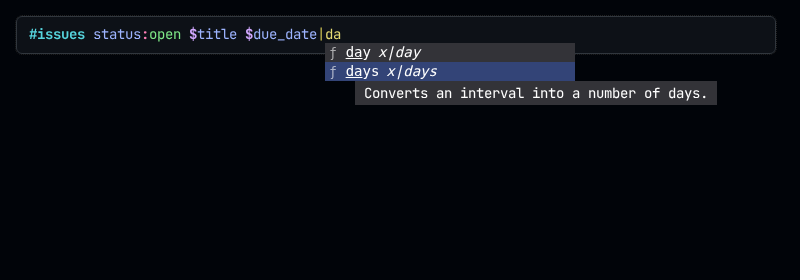

# querydown-codemirror

Syntax highlighting and autocompletion for [Querydown](https://querydown.org) in
[CodeMirror 6](https://codemirror.net/). The highlighting has light and dark palettes that follow the
editor's theme and can be customized. Autocompletion offers your database's tables and columns,
functions, variables, and (if you describe them) your application's column and query annotations.

| Light | Dark |
| -- | -- |
|  |  |

The highlighting comes from Querydown's own parser, via the `tokenize` function of the
[`querydown-js`](https://www.npmjs.com/package/querydown-js) package, so it follows the language's
rules exactly. For example, a bare word is a column in `$title`, a string in `title:performance`,
and a text search term in `#issues performance`, and each is colored accordingly. Source that
doesn't parse (as source being edited often doesn't) is still fully highlighted: past the point
where parsing fails, the highlighting falls back to a lexical one.

```sh
npm install querydown-codemirror querydown-js
```

```ts
import { EditorView } from "@codemirror/view";
import init, { tokenize } from "querydown-js";
import wasmUrl from "querydown-js/querydown_js_bg.wasm?url"; // With Vite
import { querydown } from "querydown-codemirror";

await init({ module_or_path: wasmUrl });

new EditorView({
  doc: "#issues status:open $id $title",
  extensions: [querydown({ tokenize })],
  parent: document.body,
});
```

You pass the bindings' functions in, rather than this package importing them, so that it works
however you load the compiler. Use the same version of the two packages.

## Documentation

- [CodeMirror](https://querydown.org/docs/setup/codemirror): how to add highlighting and
  autocompletion to an editor, customize the colors, complete your application's annotations, and edit a query in
  sections. It also lists the kinds of token.
- [JavaScript](https://querydown.org/docs/setup/javascript): the bindings that this package builds on
- [The language](https://querydown.org/docs/language), and a
  [playground](https://querydown.org/playground) that uses this package

| Light | Dark |
| -- | -- |
|  |  |
|  |  |

## Development

The package has Playwright tests that render a set of sample queries in light and dark editors and
compare them with the screenshots in `test/snapshots`, and that type into an editor to check what is
completed. See "Syntax highlighting, autocompletion, and their tests" in
[DEVELOPMENT.md](https://github.com/seancolsen/querydown/blob/main/DEVELOPMENT.md).

## License

MIT
