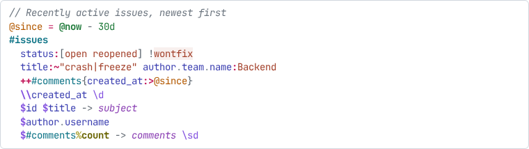
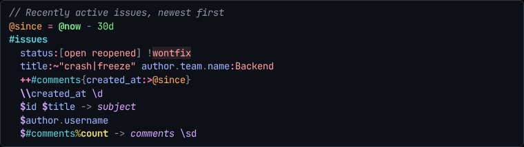

# Querydown for CodeMirror 6

Syntax highlighting for [Querydown](https://github.com/seancolsen/querydown) in
[CodeMirror 6](https://codemirror.net/), with light and dark palettes that follow the editor's theme
and can be customized.

| Light | Dark |
| -- | -- |
|  |  |

The highlighting comes from Querydown's own parser, via the `tokenize` function of the
[JavaScript bindings](../js/README.md), so it follows the language's rules exactly. For example, a
bare word is a column in `$title`, a string in `title:performance`, and a text search term in
`#issues performance`, and each is colored accordingly. Source that doesn't parse (as source being
edited often doesn't) is still fully highlighted: past the point where parsing fails, the
highlighting falls back to a lexical one.

Like the bindings, this package is **not published to npm**. Build it from a git checkout.

## Building

From the repository root:

```sh
# The bindings, which provide `tokenize` (see ../js/README.md for the build targets)
wasm-pack build bindings/js --target web

# This package, into bindings/codemirror/dist
cd bindings/codemirror && npm install && npm run build
```

Point your app's dependency at `bindings/codemirror` (or copy its `package.json` and `dist/`). The
package's peer dependencies are `@codemirror/language`, `@codemirror/state`, `@codemirror/view`,
`@lezer/common`, and `@lezer/highlight`, which a CodeMirror app already has.

## Usage

Pass the bindings' `tokenize` function to `querydown()`, which returns the language together with
its highlighting:

```ts
import { EditorView } from "@codemirror/view";
import init, { tokenize } from "querydown-js";
import wasmUrl from "querydown-js/querydown_js_bg.wasm?url";
import { querydown } from "querydown-codemirror";

await init(wasmUrl);

new EditorView({
  doc: "#issues status:open $id $title",
  extensions: [querydown({ tokenize })],
  parent: document.body,
});
```

`tokenize` is passed in, rather than imported by this package, so that it works however you built
and initialized the bindings. Initialize them before the editor first renders. If `tokenize` throws
(e.g. because the bindings aren't initialized), the editor still works, just without highlighting,
and the error is logged to the console once.

### Editors for sections of a query

If your app edits a query in sections (as passed to the bindings' `compile_sections`), tell each
editor which section it holds, so that its text is read with that section's grammar:

```ts
querydown({ tokenize, grammar: "conditions" }); // or "definitions", "sorting", "display"
```

The default grammar, `"query"`, is for a whole query.

### What you get

Besides highlighting, the language declares Querydown's comment syntax (`//` and `/* */`, for
CodeMirror's comment toggling commands) and its brackets (for `closeBrackets()`), and its syntax tree
lets `bracketMatching()` pair up brackets while skipping those within strings.

Each edit re-tokenizes the whole document. That takes around a millisecond for a typical query, so
the language doesn't attempt incremental parsing.

## Light and dark themes

`querydown()` installs `querydownHighlighting()`, which colors tokens with `lightPalette` in editors
with a light theme and with `darkPalette` in editors with a dark one. CodeMirror knows an editor's
theme is dark when a theme extension says so, as `EditorView.theme(spec, { dark: true })` and themes
like `@codemirror/theme-one-dark` do. Otherwise, it assumes light.

## Customizing the colors

Override the colors of whichever kinds of token you like, separately for light and dark themes. Each
entry is either a CSS color or a style object:

```ts
import { querydown, querydownHighlighting } from "querydown-codemirror";

querydown({
  tokenize,
  highlighting: querydownHighlighting({
    light: {
      column: "#005cc5",
      "base-table": { color: "#22863a", fontWeight: "bold", textDecoration: "underline" },
    },
    dark: { column: "#79b8ff" },
  }),
});
```

Style objects accept `color`, `backgroundColor`, `fontWeight`, `fontStyle`, and `textDecoration`. An
entry of `null` leaves that kind of token unstyled.

Colors may be CSS custom properties, which lets your stylesheet (and your app's own light/dark
switching) control them:

```ts
querydownHighlighting({
  light: { column: "var(--querydown-column)" },
  dark: { column: "var(--querydown-column)" },
});
```

To start from scratch rather than from the default palettes, build a style from a palette of your own
with `querydownHighlightStyle(palette, { themeType })` and install it with CodeMirror's
`syntaxHighlighting()`. Pass `highlighting: false` to `querydown()` so it doesn't also install the
default highlighting.

### With your own `HighlightStyle`

Every token carries two highlighting tags:

- a Querydown-specific one from `querydownTags` (e.g. `querydownTags.column`), and
- the closest standard tag from `@lezer/highlight` (e.g. `tags.propertyName`), listed in
  `standardTags`.

So a `HighlightStyle` written for other languages, like CodeMirror's `defaultHighlightStyle` or
`oneDarkHighlightStyle`, colors Querydown sensibly, and you can target Querydown's roles precisely in
a style of your own:

```ts
import { HighlightStyle, syntaxHighlighting } from "@codemirror/language";
import { querydownTags } from "querydown-codemirror";

const style = HighlightStyle.define([
  { tag: querydownTags["search-term"], color: "#b31d28", fontStyle: "italic" },
]);
```

## Kinds of token

| Kind | Examples |
| -- | -- |
| `comment` | `// note`, `/* note */` |
| `string` | `"open"`, `'open'`, and the bare `open` in `status:open` |
| `string-escape` | `\n` within a string |
| `search-term` | `backend` in `#issues backend` (searches the table's text) |
| `number`, `duration`, `date` | `42`, `3d`, `@2024-01-31` |
| `constant` | `@true`, `@null`, `@now` |
| `variable` | `@user_id`, a function's `@x` |
| `base-table` | `#issues` at the start of a query |
| `table` | `#comments`, the `project` in `>>project` |
| `column` | `title`, `` `due date` `` |
| `function` | `upper` in `\|upper`, `@@max` |
| `aggregate-function` | `count` in `%count`, window functions |
| `pipe` | `\|`, `%`, `%%` |
| `comparison-operator` | `:`, `:=`, `:>=`, `:~` |
| `operator` | `+ - * /`, `!`, `,`, `..`, `->` |
| `has-quantity` | `++`, `--` |
| `glob` | `*` in `$*` |
| `case` | `?`, `~`, `~~` |
| `path-separator` | `.`, `>>` |
| `result-column` | `$` |
| `sort` | `\\` |
| `flag` | `\sd`, `\g` |
| `alias` | `total` in `-> total` |
| `annotation`, `annotation-key` | the `@` and the `width` in `@{width:100}` |
| `pipeline` | `~~~` |
| `definition` | `=`, `=>` in definitions |
| `bracket` | `( ) [ ] { }` |
| `punctuation` | the `:` in `@{width:100}` |
| `invalid` | a character that can't begin any Querydown syntax |

`TOKEN_KINDS` lists them all.

## Development

The package has Playwright visual tests that render a set of sample queries in light and dark editors
and compare them with the screenshots in [test/snapshots](test/snapshots). See "Syntax highlighting
and its visual tests" in [DEVELOPMENT.md](../../DEVELOPMENT.md).
