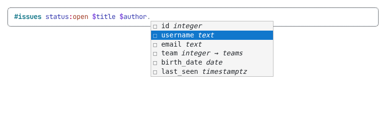
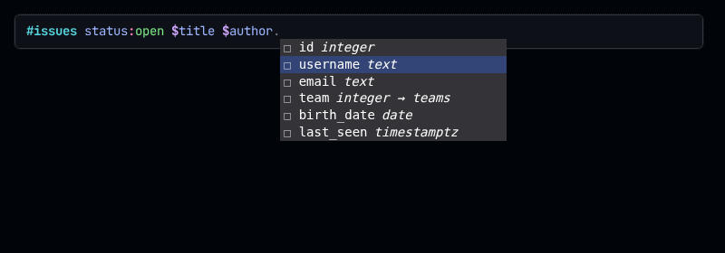
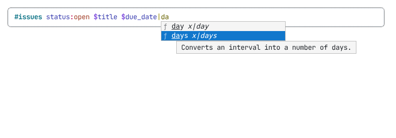

# Querydown for CodeMirror 6

Syntax highlighting and autocompletion for [Querydown](https://github.com/seancolsen/querydown) in
[CodeMirror 6](https://codemirror.net/). The highlighting has light and dark palettes that follow the
editor's theme and can be customized. Autocompletion offers your database's tables and columns,
functions, variables, and (if you describe them) your application's column and query annotations.

| Light | Dark |
| -- | -- |
|  |  |

The highlighting comes from Querydown's own parser, via the `tokenize` function of the
[JavaScript bindings](../js/README.md), so it follows the language's rules exactly. For example, a
bare word is a column in `$title`, a string in `title:performance`, and a text search term in
`#issues performance`, and each is colored accordingly. Source that doesn't parse (as source being
edited often doesn't) is still fully highlighted: past the point where parsing fails, the
highlighting falls back to a lexical one.

Like the bindings, this package is **not published to npm** yet. Build it from a checkout of the
repository:

```sh
# The bindings, which provide `tokenize` and the completer
wasm-pack build bindings/js --target web

# This package, into bindings/codemirror/dist
cd bindings/codemirror && npm install && npm run build
```

## Documentation

- [Installation](../../docs/setup/installation.md#build-the-codemirror-package): how to build the
  package and depend on it
- [CodeMirror](../../docs/setup/codemirror.md): how to add highlighting and autocompletion to an
  editor, customize the colors, complete your application's annotations, and edit a query in
  sections. It also lists the kinds of token.
- [JavaScript](../../docs/setup/javascript.md): the bindings that this package builds on

| Light | Dark |
| -- | -- |
|  |  |
|  |  |

## Development

The package has Playwright tests that render a set of sample queries in light and dark editors and
compare them with the screenshots in [test/snapshots](test/snapshots), and that type into an editor
to check what is completed. See "Syntax highlighting, autocompletion, and their tests" in
[DEVELOPMENT.md](../../DEVELOPMENT.md).
