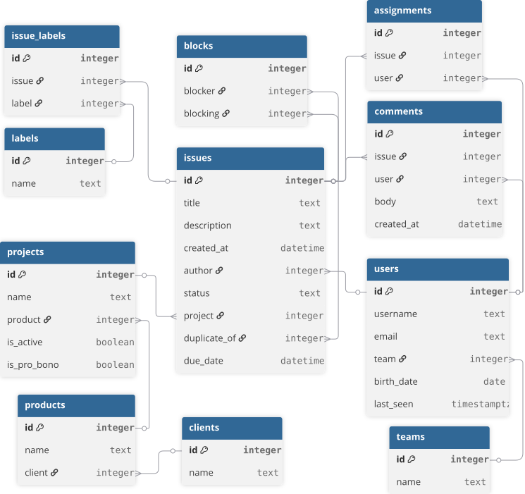

# Querydown Language Guide

_Also see the **[Cheat Sheet](./cheat-sheet.md)** for a quicker reference._

<!-- START doctoc generated TOC please keep comment here to allow auto update -->
<!-- DON'T EDIT THIS SECTION, INSTEAD RE-RUN doctoc TO UPDATE -->

- [Example schema](#example-schema)
- [Query anatomy](#query-anatomy)
- [Values](#values)
  - [Identifiers (table names and column names)](#identifiers-table-names-and-column-names)
  - [Flexible identifiers](#flexible-identifiers)
  - [Built-in constants](#built-in-constants)
  - [String literals](#string-literals)
  - [Flagged strings](#flagged-strings)
    - [The `f` flag](#the-f-flag)
    - [The `e` flag](#the-e-flag)
  - [Date literals](#date-literals)
  - [Duration literals](#duration-literals)
- [Computations](#computations)
  - [Arithmetic](#arithmetic)
  - [Function piping](#function-piping)
  - [Case expressions](#case-expressions)
  - [Anonymous functions](#anonymous-functions)
  - [Function calling](#function-calling)
- [Comparisons and conditions](#comparisons-and-conditions)
  - [Match comparisons](#match-comparisons)
  - [Equality comparisons](#equality-comparisons)
  - [Numeric comparisons](#numeric-comparisons)
  - [Comparing dates with durations](#comparing-dates-with-durations)
  - [Regular expression matching](#regular-expression-matching)
    - [Regex flags](#regex-flags)
  - [All comparison operators](#all-comparison-operators)
  - [Bare text on the right-hand-side of a comparison](#bare-text-on-the-right-hand-side-of-a-comparison)
    - [The rule applies at any depth](#the-rule-applies-at-any-depth)
    - [Everything _outside_ the right-hand-side is a column reference](#everything-outside-the-right-hand-side-is-a-column-reference)
    - [Referencing a column on the right-hand-side](#referencing-a-column-on-the-right-hand-side)
  - [Default text search](#default-text-search)
    - [Configuring the default text search](#configuring-the-default-text-search)
  - [AND condition sets](#and-condition-sets)
  - [OR condition sets](#or-condition-sets)
  - [Nested condition sets](#nested-condition-sets)
  - [Negation](#negation)
  - [Comparison expansion](#comparison-expansion)
    - [Without comparison expansion](#without-comparison-expansion)
  - [Dual expansion](#dual-expansion)
  - [Ranges](#ranges)
- [Result columns](#result-columns)
  - [Aliasing result columns](#aliasing-result-columns)
  - [Basic sorting](#basic-sorting)
  - [Descending sorting](#descending-sorting)
  - [Multiple sorting](#multiple-sorting)
  - [Sorting NULL values](#sorting-null-values)
  - [Grouping and aggregation](#grouping-and-aggregation)
    - [Grouping with related records](#grouping-with-related-records)
    - [Filtering on an aggregate](#filtering-on-an-aggregate)
  - [Column globs](#column-globs)
  - [Column glob on related table](#column-glob-on-related-table)
  - [Hiding columns within a glob](#hiding-columns-within-a-glob)
  - [Sorting columns within a glob](#sorting-columns-within-a-glob)
  - [Nesting result columns](#nesting-result-columns)
- [Sorting outside of result columns](#sorting-outside-of-result-columns)
  - [Scoped sorting expressions](#scoped-sorting-expressions)
- [Referencing _single_ related records](#referencing-single-related-records)
  - [Single related records via column name chains](#single-related-records-via-column-name-chains)
  - [Scoped comparisons](#scoped-comparisons)
- [Referencing _multiple_ related records](#referencing-multiple-related-records)
  - [Mandatory aggregation](#mandatory-aggregation)
  - [Aggregate counts](#aggregate-counts)
  - [Specifying an aggregate function](#specifying-an-aggregate-function)
    - [Aggregating a computed value](#aggregating-a-computed-value)
  - [Sorting within an aggregate function](#sorting-within-an-aggregate-function)
    - [Sorting by the aggregated value](#sorting-by-the-aggregated-value)
    - [The context of a sorting expression](#the-context-of-a-sorting-expression)
    - [Sorting distinct values](#sorting-distinct-values)
    - [Keeping only the top values](#keeping-only-the-top-values)
  - ["Has some" and "has none" conditions](#has-some-and-has-none-conditions)
  - [Conditions to filter aggregate data](#conditions-to-filter-aggregate-data)
  - [Transitive relationships](#transitive-relationships)
  - [Related tables with single vs multiple records](#related-tables-with-single-vs-multiple-records)
  - [Ambiguous paths](#ambiguous-paths)
  - [Intersecting paths](#intersecting-paths)
  - [Specifying the linking column](#specifying-the-linking-column)
- [Pipeline of multiple queries](#pipeline-of-multiple-queries)
- [Union of multiple queries](#union-of-multiple-queries)
- [Window functions](#window-functions)
  - [Filtering on a window function](#filtering-on-a-window-function)
  - [Limitations](#limitations)
- [Variables](#variables)
  - [User-defined constants](#user-defined-constants)
  - [Defining a constant using the result of a query](#defining-a-constant-using-the-result-of-a-query)
  - [Computed columns](#computed-columns)
  - [User-defined functions](#user-defined-functions)
  - [Function with multiple parameters](#function-with-multiple-parameters)
  - [Function containing an assignment](#function-containing-an-assignment)
  - [Custom Comparisons](#custom-comparisons)
  - [Linked record comparisons](#linked-record-comparisons)
  - [User-defined tables](#user-defined-tables)
- [Annotations](#annotations)
  - [Column-level annotations](#column-level-annotations)
    - [The annotation output](#the-annotation-output)
    - [Querydown's JSON variant](#querydowns-json-variant)
  - [Query-level annotations](#query-level-annotations)
- [Limit and offset](#limit-and-offset)
- [Things you can't do (yet?)](#things-you-cant-do-yet)

<!-- END doctoc generated TOC please keep comment here to allow auto update -->

## Example schema

These examples use an fictitious **[issue-tracker schema](../compiler/resources/test/issue_schema.json)** (unless otherwise noted).



_(ER diagram generated via https://dbdiagram.io/d/64a1d25202bd1c4a5e5fefba)_

## Query anatomy

```qd
 #issues   status:"open" due_date:<@now   $id $title $author.*   /*
╰───────╯ ╰────────────────────────────╯ ╰────────────────────╯   *
Base table          Conditions               Result columns       */
```

- The **base table** always comes first. Every query has one and only one base table.
- **[Conditions](#conditions)** can follow the base table, separated by spaces. If omitted, then all rows in the table are returned.
- **[Result columns](#result-columns)** are specified via expressions following a dollar sign `$`. If omitted, then all columns in the table are returned.
- A query with conditions _and_ result columns must specify them in that order.
- Most white space doesn't matter.
- Comments are possible with `//` for single line or `/* */` for multi-line


## Values

### Identifiers (table names and column names)

- Table names are always prefixed with a `#` sigil, e.g. `#issues`
- Column names are written as-is, e.g. `due_date`.
- Identifiers can include special characters when quoted with backticks e.g. `` `Due Date` ``. Like [strings](#string-literals), quoted identifiers are raw, so a backslash is literal and an identifier can't contain a backtick.
- Unquoted identifiers must:
    - begin with a lowercase letter or uppercase letter or underscore
    - include only letters, numbers, and underscores.
- Unlike SQL, column names like `group` and `year` don't need quotes because there are no keywords and functions names are always clear to the parser from other syntax.
- Note that a bare (unquoted) word on the [right-hand-side of a comparison](#bare-text-on-the-right-hand-side-of-a-comparison) is parsed as a string literal, not a column reference. Use backticks there if you need to reference a column.
- Likewise, an unquoted word made up of only letters and digits that stands alone as a condition is a [default text search](#default-text-search) term, not a column reference.

### Flexible identifiers

Table and column names are resolved "flexibly" to reduce (but not entirely eliminate) the need for quoting identifiers in backticks.

If a table or column isn't found exactly as specified, then the compiler attempts to find a _unique_ match with a flexible strategy comparing only lowercased ASCII letters and numbers. This means that `foo_bar` will resolve to `Foo Bar`, but only if it doesn't also resolve to any other identifiers like `foobar`.

_(This behavior will likely be configurable in a future version.)_

### Built-in constants

| Querydown | SQL |
| -- | -- |
| `@now`      | `now()`    |
| `@infinity` | `CAST('infinity' AS double precision)` |
| `@true`     | `TRUE`     |
| `@false`    | `FALSE`    |
| `@null`     | `NULL`     |

Additional constants can be [defined](#user-defined-constants).

### String literals

| Example | Explanation |
| -- | -- |
| `"foo"` | With double quotes |
| `'foo'` | With single quotes |

- Strings can be quoted with single quotes or double quotes
- Strings are raw: there are no escape sequences. A backslash is a literal character, so `'\n'` is a backslash followed by `n` rather than a newline, and a regular expression like `title:~'v\d+'` needs no doubled backslashes.
- A string can't contain its own quote character, so quote it with the other one instead, e.g. `"can't"` or `'say "hi"'`. For a string containing both kinds of quote, use a [flagged string](#flagged-strings).
- Strings may span multiple lines.

### Flagged strings

Strings can be prefixed with `^` and some flags to alter their behavior.

| Example | Explanation |
| -- | -- |
| `^f"Hello {username}!"`   | Using the `f` flag to interpolate values |
| `^e'Don\'t say "never"'` | Using the `e` flag to interpret escape sequences |
| `^^Don't say "never"^`   | Using a custom quote character to avoid escape sequences |

| Flag | Meaning |
| --   | -- |
| `f`  | **format**: interpolate the expressions written within `{ }` |
| `e`  | interpret **escape** sequences (strings are raw by default) |

- The flags follow `^` directly, in any order. Each may be given at most once, and they're case-sensitive.
- The flags can also be omitted, so `^` alone can prefix a string. This is still a "flagged string", and is useful for its choice of quotes.
- A flagged string may be quoted with any of the following characters: `" ' ^ # / |`. Choose one the string doesn't contain, e.g. `^/v\d+/` or `^|say "can't"|`.
- Like other strings, flagged strings may span multiple lines.

#### The `f` flag

> Show each user's name and email address, formatted together as one value.

```qd
#users $^f"{username} <{email}>" -> contact
```

- Any expression can be interpolated, e.g. `^f"{title|uppercase} ({#comments} comments)"`.
- Within `{ }`, a bare word is always a column reference, even on the [right-hand-side of a comparison](#bare-text-on-the-right-hand-side-of-a-comparison). For example, `description:^f"see {title}"` finds issues whose description contains the text "see " followed by the issue's own title.
- The string ends at the first quote character _outside_ of the `{ }`, so an expression within the braces can contain the quote character, e.g. `^f"{status|concat("!")}"`. It may even contain another formatted string.
- To write a literal brace, double it: `{{` or `}}`.
- An interpolated value that isn't text is converted to text, and a `NULL` value becomes empty text. (The string compiles to SQL `concat`.)
- There are no format specifiers like Python's `{x:.2f}`. Within the braces, `:` is a [comparison](#comparisons-and-conditions) as usual, so `{a:b}` interpolates a boolean. To format a value, pipe it to a [function](./functions.md) instead.
- Like any string, a formatted string standing alone as a condition is a [default text search](#default-text-search).

#### The `e` flag

The `e` flag interprets these escape sequences:

| Escape | Meaning |
| -- | -- |
| `\\` | a backslash |
| `\n` | a newline |
| `\t` | a tab |
| `\r` | a carriage return |
| `\u{e9}` | the Unicode character with the given hexadecimal code point (one to six digits), here `é` |
| `\"` | the string's quote character, whichever it is, e.g. `\'` in `^e'it\'s'` |
| `\{` and `\}` | a literal brace, with the `f` flag |

Any other character after a backslash is an error.

### Date literals

Literal dates can be written in [ISO-8601](https://en.wikipedia.org/wiki/ISO_8601) format with a `@` prefix, e.g. `@2000-01-01`.

There is no literal syntax for a time of day yet, so a timestamp like `@2000-01-01T08:30:00` is a syntax error. A date literal compared against a timestamp column means midnight at the start of that date.

### Duration literals

A literal duration is a non-empty sequence of parts, where each part is a number immediately followed by a case-insensitive unit. The units are:

| Unit  | Meaning |
| --    | --      |
| `y`   | years   |
| `m`   | months  |
| `w`   | weeks   |
| `d`   | days    |
| `h`   | hours   |
| `min` | minutes |
| `s`   | seconds |

Note that `m` always means months and `min` always means minutes, so the two are never ambiguous.

| Example         | Meaning |
| --              | -- |
| `2y`            | 2 years |
| `2.5y`          | 2.5 years |
| `1y2d`          | 1 year and 2 days |
| `9m`            | 9 months |
| `9min`          | 9 minutes |
| `1h`            | 1 hour |
| `2y6m3d8h9min34.89s` | 2 years, 6 months, 3 days, 8 hours, 9 minutes, and 34.89 seconds |
| `0y`            | (empty) |


## Computations

### Arithmetic

Basic arithmetic operators are supported in expressions, along with their standard precedence.

| Operator | Meaning |
| -- | -- |
|  `+` | Addition |
|  `-` | Subtraction |
|  `*` | Multiplication |
|  `/` | Division |

No other math operators exist. All other functions must be applied by name.

### Function piping

Scalar functions can be applied to values via `|` (pipe) syntax.

> Show issues, along with the number of days until the due date.

```qd
#issues $* $due_date|countdown|days
```

- See a list of [all named functions](./functions.md).
- Pipe has the highest [operator precedence](./cheat-sheet.md#operator-precedence), meaning that it gets evaluated before multiplication or division.
- Note that [_aggregate_ functions](#specifying-an-aggregate-function) are applied via `%` instead of `|`.

### Case expressions

Use `?`, `~` and `~~` for case expressions, which are similar to if/else (ternary) expressions.

> Categorize each issue into being either "overdue", "due soon", or "due later".

```qd
#issues
$title
$ ?
  due_date|countdown|days:<0  ~ "overdue"
  due_date|countdown|days:<30 ~ "due soon"
  ~~ "due later"
```

- `?` begins a case expression.
- `~` denotes a case variant by separating its test expression from its corresponding value expression.
- `~~` prefixes the fallback value and indicates the end of the case expression.

A case expression requires at least one variant and a fallback. It compiles to a SQL `CASE` expression, evaluating the variants in order and yielding the value of the first variant whose test expression is true, or the fallback if none are.

### Anonymous functions

> Categorize each issue into being either "overdue", "due soon", or "due later".

```qd
#issues
$title
$due_date|countdown|days|(@d => ? @d:<0~"overdue" @d:<30~"due soon" ~~"due later")
```

In the code above:

1. `due_date|countdown|days` computes the number of days until the issues's due date
1. That value is fed into the `@d` argument of the anonymous function:

    ```
    (@d => ? @d:<0~"overdue" @d:<30~"due soon" ~~"due later")
    ```

1. The body of the anonymous function can reference `@d` as the number of days until the issues due date, using the same value in multiple places with minimal repetition.

An anonymous function can take more than one parameter. The piped-in value binds to the first parameter, and the remaining arguments are supplied in parentheses (separated by spaces) directly after the function:

```qd
#issues
$title
$due_date|countdown|days|(@due @age => ? @due:<0 ~ "overdue" @age:>365 ~ "stale" ~~ "on track")(created_at|age|days)
```

Here `@due` is the number of days until the due date (piped in), and `@age` is the number of days since the issue was created (from the trailing `(created_at|age|days)`).

### Function calling

Use `@@` to call a function without using a pipe.

> For each issue, show the number of days it is overdue. Display zero instead of negative numbers

```qd
#issues $title $@@max(due_date|age|days 0)
```

Notice:

- The `max` function is prefixed with the `@@` sigil.
- It takes two arguments which are separated by _space_. No commas!

The above query is equivalent to:

```qd
#issues $title $due_date|age|days|max(0)
```

Sometimes the pipe syntax is more readable. Other times the direct call is more readable.

## Comparisons and conditions

### Match comparisons

> Find issues where the title contains "performance"

```qd
#issues title:"performance"
```

This does a case-insensitive search for "performance" anywhere in the issue title.

The match comparison operator (`:`) behaves differently according to the type of expression on the left-hand-side. Text values will match via contains logic, while other values (e.g. numbers, dates, etc) are compared using strict equality.

As a special case, matching a text value against an **empty string** uses strict equality rather than contains logic (which would otherwise match every row). This means `#issues description:""` finds issues with an empty description, the same as `#issues description:==""`.

### Equality comparisons

> Find issues where the status equals "do", ignoring case

```qd
#issues status:="do"
```

The `:=` operator performs a **case-insensitive** equality comparison on text. It will find issues whose status is "do" or "Do", but _not_ "done".

To compare text **case-sensitively**, use `:==` instead:

> Find issues where the status is exactly "do"

```qd
#issues status:=="do"
```

For non-text values (numbers, dates, etc.), case sensitivity is meaningless, so both `:=` and `:==` behave identically, falling back to strict equality.

### Numeric comparisons

> Find issue with id 123

```qd
#issues id:123
```

Note that the match operator falls back to an equality comparison here because the id column is not text. Here `id:123` is the same is `id:=123`.

The comparison operators `:<` `:<=` `:>` `:>=` also allow you to perform inequality comparisons on numeric, datetime, and duration types.

### Comparing dates with durations

When you compare a date or datetime against a [duration](#duration-literals), Querydown interprets the comparison as a question about how far the date lies from _now_, in either direction. The comparison `date:<duration` matches when the date falls within `duration` of the present moment &mdash; whether the date is in the past or the future.

> Find issues created within the past 6 months:

```qd
#issues created_at:<6m
```

> Find issues due within 6 months:

```qd
#issues due_date:<6m
```

Both queries use `:<`, even though one date lies in the past and the other in the future. Under the hood the comparison compiles to `ABS(NOW() - date) < duration`, so the sign of the difference doesn't matter.

The date must be on the **left** and the duration on the **right**. The reversed order is an error, just as comparing a datetime against a duration directly would be.

Neither side needs to be written literally. Querydown infers the type of each expression, propagating it through functions, arithmetic, and [variables](#variables), so any expression that works out to a date or datetime can be compared against any expression that works out to a duration. For example, a datetime run through an aggregate function is still a datetime:

> Find issues whose most recent comment was made within the past week:

```qd
#issues #comments.created_at%max:<1w
```

And a sum of durations is still a duration, as is a [constant](#user-defined-constants) that holds one:

> Find issues created within the past 8 days:

```qd
#issues created_at:<1w + 1d
```

The _difference_ between two dates is a duration too, not a date. So comparing it against a duration is an ordinary comparison of two durations, with nothing measured from now:

> Find issues that were given more than a week to complete:

```qd
#issues due_date - created_at:>1w
```

The types that this relies on come from the schema, so the comparison works on any column of a table. It also works on the columns of an earlier [pipeline](#pipeline-of-multiple-queries) stage or a [user-defined table](#user-defined-tables), which keep their date, datetime, and duration types.

If you actually want to account for the direction of the difference, compare against a datetime instead of a duration. For example, to find issues that are more than 1 week overdue:

```qd
#issues due_date:<@now|minus(1w)
```

### Regular expression matching

> Find issues with a description matching the regex `front[ -]?end`

```qd
#issues description:~'front[ -]?end'
```

Regex matching is case-insensitive by default. Patterns are [raw strings](#string-literals), so a backslash reaches the regex engine intact (e.g. `'v\d+'`). The regex syntax itself is your database's: [POSIX-style "advanced" regular expressions](https://www.postgresql.org/docs/current/functions-matching.html#POSIX-SYNTAX-DETAILS) in Postgres, and [RE2](https://github.com/google/re2/wiki/Syntax) in DuckDB.

#### Regex flags

To change how a regex matches, write flags between the `:` and the `~` of the operator, after a backslash:

> Find issues whose title starts with "Fix", matching case-sensitively

```qd
#issues title:\c~'^Fix'
```

| Flag | Effect |
| -- | -- |
| `c` | Match case-sensitively. |
| `m` | Multi-line: `^` and `$` match at the start and end of each line, rather than only at the start and end of the whole text. |
| `s` | Dot-all: `.` matches a newline too. |

The flags may be combined in any order, e.g. `\ms`.

> Find issues whose description has a line consisting only of "TODO"

```qd
#issues description:\cm~'^TODO$'
```

Without any flags, a regex matches the same way in every database: case-insensitively, with `.` matching any character _except_ a newline, and with `^` and `$` matching only at the start and end of the whole text. The `m` and `s` flags mean what they do in Python (and JavaScript, Perl, etc.). There's no `i` flag, since case-insensitivity is the default. Python's `x`, `a`, `u`, and `L` flags aren't supported, because the databases don't support them.

A few behaviors differ between databases, because Querydown hands the pattern to the database's own regex engine:

- In Postgres, a negated bracket expression such as `[^a]` doesn't match a newline unless the `s` flag is given. In DuckDB (and Python) it always does.
- Postgres lets an embedded options group like `(?x)` appear only at the very start of a pattern, but Querydown already puts its own options there. Use Querydown's flags instead.

### All comparison operators

the Cheat Sheet lists all [comparison operators](./cheat-sheet.md#comparison-operators).

### Bare text on the right-hand-side of a comparison

A bare (unquoted) word on the **right-hand-side** of a comparison is interpreted as a **string literal** rather than a column reference. This matches the behavior you may expect from tools like GitHub.

> Find issues where the title contains the word "performance"

```qd
#issues title:performance
```

The query above is equivalent to `#issues title:"performance"`.

Here, "word" means any unquoted identifier, so it may contain underscores: `#issues status:in_progress` compares against the text "in_progress". (That's unlike a [default text search](#default-text-search) term, which is made up of letters and digits only.)

#### The rule applies at any depth

This is not limited to a bare word standing alone immediately after the operator. **Every** bare word _anywhere_ within the right-hand-side expression — at any depth of nesting — is a string literal. For example, the bare words inside the following right-hand-sides are all string literals:

- an [expansion](#comparison-expansion): `#issues title:~[color colour]` searches for "color" or "colour"
- a [function pipeline](#function-piping): `#issues title:foo|concat(bar)` builds the string from the literals "foo" and "bar"
- a [range](#ranges): `#issues title:a..m` finds the titles that sort between "a" and "m"
- parentheses, arithmetic, and so on — the same rule reaches into all of them

The motivation is to make the most common case — searching for literal text — both the shortest to type and the most intuitive to read.

#### Everything _outside_ the right-hand-side is a column reference

The string-literal rule is confined to the right-hand-side. Anywhere else, a bare word is still a column reference. Contrast the two pipelines below, which are written identically except for their position:

```qd
#issues title:foo|concat(bar)
```

Here `foo` and `bar` are **string literals**, because they sit on the right-hand-side of `title:`.

```qd
#issues $status|concat(title)
```

Here `status` and `title` are **column references**, because this is a [result column](#result-columns), not the right-hand-side of a comparison.

This boundary even resets within a nested comparison. In `#projects is_active:(name:foo)`, the inner `name` is on the _left_ of its own comparison, so it is a column reference, while `foo` (on the inner right-hand-side) remains a string literal.

It also resets within the `{ }` of a [formatted string](#the-f-flag). In `#issues description:^f"see {title}"`, `title` is a column reference.

#### Referencing a column on the right-hand-side

If you need to reference a column on the right-hand-side, you can either:

- quote the identifier with backticks, e.g. ``#issues description:`title` ``, or
- write it as a multi-part path, e.g. `#issues description:foo.bar`.

### Default text search

> Find issues where the title or description or status contain the word "accessibility" — and the title or description or status contain the word "feature"

```qd
#issues accessibility feature
```

The default text search is a simple way to give users a low-friction search across many columns at once. The reason the above example searches in `title`, `description` and `status` is because those are the only text-like columns in the `issues` base table — but you can see the next section to learn how to customize this behavior.

In the above example, "feature" is parsed as a default text search term because it comes before any display columns and it does not have a comparison operator.

Only a **bare word** is a search term: an unquoted word that begins with a letter and contains only letters and digits. A bare word is _always_ a search term, even when it happens to match a column name — so `#issues title` searches for the literal text "title" rather than referencing the `title` column.

Anything else that looks like a name is a column reference, as it is elsewhere in a query. In particular, a name containing an **underscore** isn't a bare word:

> Find active projects (`is_active` is a boolean column)

```qd
#projects is_active
```

So `#issues in_progress` doesn't search for "in_progress": it refers to a column named `in_progress`, and fails because there isn't one. To search for such text, quote it (`#issues "in_progress"`).

Going the other way, to use a column whose name _is_ a bare word as a condition, quote it with backticks, just as you would on the [right-hand side of a comparison](#bare-text-on-the-right-hand-side-of-a-comparison). If `projects` had a boolean column named `archived`, then `#projects archived` would search for the text "archived", while this would find the archived projects:

```qd
#projects `archived`
```

You can search for any string using the default text search if you explicitly quote it:

```qd
#issues "localhost:3000"
```

Because the comma is shorthand for an [OR condition set](#or-condition-sets), bare terms can be combined with it to search for either term:

```qd
#issues foo,bar
```

Each side of a comma is a whole condition, so the same is true after a comparison: `#issues status:open,closed` finds issues whose status contains "open", _or_ that mention "closed" in any text column. See [OR condition sets](#or-condition-sets) for how to compare one column with several values.

You can _negate_ a search term by prefixing it with `!`, to find records that do **not** contain the term in any of their text columns:

```qd
#issues !backend
```

Negation works on individual comma operands too, so you can mix positive and negative terms. This finds issues that mention "foo" or do not mention "bar":

```qd
#issues foo,!bar
```

Just as a bare word is always a search term (never a column reference), a `!`-prefixed bare word is always a _negated_ search term. A name that isn't a bare word is a column, negated or not, so `#projects !is_active` finds the projects that aren't active. To negate a column whose name is a bare word, quote it with backticks, e.g. ``#projects !`archived` ``.

A [constant](#user-defined-constants) that holds a string is a search term too, since a constant stands for its value:

```qd
@term = "localhost:3000"
#issues @term
```

#### Configuring the default text search

You can use [custom comparisons](#custom-comparisons) to customize the default text search columns to your liking.

Here we customize the default text search for the issues table, removing the `status` column (that would have otherwise been chosen automatically), and adding logic to search within all comments.

```qd
#issues.__querydown_default_text_search:@x = [
  title:@x
  description:@x
  ++#comments{body:@x}
]

#issues accessibility feature
```

### AND condition sets

Curly brackets `{ }` enclose multiple `AND` conditions.

> Issues that are open **and** created after 2023-03-04

```qd
#issues {status:"open" created_at:>@2023-03-04}
```

At the top level, a set of AND conditions is inferred if no brackets are present, so the above query is identical to:

```qd
#issues status:"open" created_at:>@2023-03-04
```

### OR condition sets

Square brackets `[ ]` enclose `OR` conditions.

> Issues that are open **or** created after 2023-03-04

```qd
#issues [status:"open" created_at:>@2023-03-04]
```

A shorthand syntax is also available using the comma `,` operator:

```qd
#issues status:"open",created_at:>@2023-03-04
```

The comma has the lowest [precedence](./cheat-sheet.md#operator-precedence) of any operator, so it always separates whole conditions. It never separates the values of one comparison:

- `status:open,closed` is the comparison `status:open`, _or_ a [default text search](#default-text-search) for "closed" in every text column.
- `id:1,2` is an error, because the `2` stands alone, and a number isn't a condition.

To compare one column with several values, use [comparison expansion](#comparison-expansion) instead: `status:[open closed]` or `id:[1 2]`.

### Nested condition sets

Conditions can be nested

> Issues that are open and created after 2023-03-04 _or_ reopened and created after 2022-11-22:

```qd
#issues [
  {status:"open" created_at:>@2023-03-04}
  {status:"reopened" created_at:>@2022-11-22}
]
```

### Negation

Prefix a comparison, a condition set, or any other condition with `!` to negate it. `!X` finds exactly the records that `X` doesn't. Only a condition can be negated: applying `!` to a literal value, such as a string or a number, is an error.

> Issues that aren't in the "Website" project

```qd
#issues !project.name:="Website"
```

That includes issues with no project at all. A comparison whose operand is NULL (here an issue with no project has no project name) doesn't hold, so its negation does. The same goes for a nullable column (`!status:="open"` includes issues with no status) and for an aggregate over no related records:

> Issues with no comment in the past week, including issues with no comments

```qd
#issues !#comments.created_at%max:<1w
```

So you never need to add a separate `:@null` check to a negated condition. Negating a condition set works the same way: `![project.id:3 status:="closed"]` finds issues that are neither in project 3 nor closed, including open issues with no project.

In SQL terms, `!X` compiles to `X IS NOT TRUE` (or to a plain `NOT X` where `X` can't be NULL), not to a bare `NOT X`, which would be NULL and so drop the record whenever `X` is. The rule holds everywhere `!` appears, including in a result column: `#projects $!is_active` is `true`, not NULL, for a project whose `is_active` is NULL. The [`not`](./functions.md#not) function behaves the same way.

### Comparison expansion

Whenever a condition set (`[ ... ]` for "or", `{ ... }` for "and") appears on either side of a comparison, the comparison is automatically "expanded" across the entries of the set. The comparison is applied to each entry in turn, and the results are combined using the set's conjunction.

Because an expansion on the right-hand-side is part of the right-hand-side, its bare words are [string literals](#bare-text-on-the-right-hand-side-of-a-comparison). An expansion on the left-hand-side holds column references, as everywhere else on the left.

> Issues whose status is either "open" or "reopened":

```qd
#issues status:[open reopened]
```

> Issues that are missing a title and description (the left-hand expansion references columns):

```qd
#issues {title description}:@null
```

> Issues where the title or description contains "foo":

```qd
#issues [title description]:~foo
```

> Find projects that are not active and not pro-bono.

```qd
#projects {is_pro_bono is_active}:@false
```

The entries of an expansion are the things being compared, not conditions, so an entry can't be negated with `!`. Writing `status:[open !closed]` is an error, since `!` would apply to the value "closed" rather than to a comparison. Either [negate](#negation) the whole comparison, or write the comparisons out:

> Issues whose status is neither "closed" nor "done"

```qd
#issues !status:[closed done]
```

> Issues whose status contains "open", or doesn't contain "closed"

```qd
#issues [status:open !status:closed]
```

A condition set expands a comparison only when it's written directly in the comparison. A set that arrives some other way isn't an expansion: one held by a [constant](#user-defined-constants), passed as an argument to a function, or wrapped in parentheses is a single (boolean) condition, and comparing a value with it is an error.

#### Without comparison expansion

Because a condition set on either side of a comparison is _always_ expanded, you cannot use a condition set to form a boolean value to be compared. If for some reason you need to perform boolean logic on expressions _before_ they are compared, then you can use functions:

```qd
#projects is_pro_bono|and(is_active):@false
```

But beware that this query will produce different results from the one with comparison expansion! For example, if `is_pro_bono` is `TRUE` and `is_active` is `FALSE`, then `is_pro_bono|and(is_active)` will evaluate to `FALSE`, matching the condition and including the row.

### Dual expansion

If both sides of the comparison are expanded, then the brackets on the left side are used for the outer precedence. Note how the same expansion syntax yields column references on the left (`title`, `description`) but string literals on the right (`foo`, `bar`):

> Issues where the title and description both contain "foo" or contain "bar":

```qd
#issues {title description}:~[foo bar]
```

### Ranges

> Issues created in the 2010's decade

```qd
#issues created_at|year:2010..2019
```

The range `2010..2019` **includes** both 2010 and 2019. You can use `<` on either side of the `..` to make the range exclude either of the bounds. For example:

- `2010<..2019` means _"greater than 2010 and less or equal to 2019"._
- `2010..<2019` means _"greater or equal to 2010 and less than 2019"._
- `2010<..<2019` means _"greater than 2010 and less than 2019"._

A few details:

- A range is compared with `:`. The ordering and pattern operators (`:<`, `:~`, and so on) can't be used with one.
- Each bound is a **single value**: a literal (`2010`, `@2024-01-01`, `1w`), a [constant](#user-defined-constants) or built-in like `@now`, a column, or an expression in parentheses. The `..` binds more tightly than arithmetic and function pipes, so a computed bound needs parentheses: write `id:(1 + 1)..(2 * 3)` and `created_at:(@now|minus(1w))..@now`, not `id:1 + 1..2 * 3`.
- As everywhere on the [right-hand-side of a comparison](#bare-text-on-the-right-hand-side-of-a-comparison), a bare word is a string literal: `title:a..m` finds titles from "a" to "m". Use backticks for a column: ``created_at:`due_date`..@now``.
- A range is written directly on one side of a comparison. It can't be an entry of an [expansion](#comparison-expansion) (`id:[1 3..5]`), nor be wrapped in parentheses (`id:(1..5)`); both are syntax errors. To combine a range with other values, write the comparisons out: `[id:1 id:3..5]`.
- The other side of the comparison may be an expansion: `[created_at due_date]:@2024-01-01..@now`.


## Result columns

### Aliasing result columns

Use `->` after a column to give it an alias.

```qd
#issues $id->Identifier $title->Subject
```

### Basic sorting

Ascending sorting by one column. The `s` stands for "sort".

> Issues sorted by their creation date

```
#issues $title $created_at \s
```

### Descending sorting

Descending sorting is indicated via a `d` after the `s`.

```
#issues $title $created_at \sd
```

### Multiple sorting

Sorting by multiple columns is done via numbers to indicate ordinality.

```
#issues $title \s2 $created_at \sd1
```

Sorted columns without any ordinality specified are sorted in the order the appear, after all columns with indicated ordinality.

### Sorting NULL values

By default, `NULL` values are sorted last, but this behavior can be modified using the `n` flag, which stands for "nulls first".

```
#issues $title $created_at \sdn
```

### Grouping and aggregation

Grouping is indicated by the `g` flag, similar to sorting.

> For each issue status, show the number of issues and the date of the most recently created issue

```
#issues $status \g $%count $created_at%max
```

- All ungrouped columns must contain an aggregate function. Otherwise the compiler reports an error.
- `%count` can occur on its own (outside of a function pipeline), which is equivalent to `count(*)`.
- Aggregate functions like `%max`, `%sum`, and `%avg` may be applied to columns on the base table (e.g. `created_at%max`) or on a related table reachable via a single record (e.g. `author.created_at%max`), and to [values computed from such a column](#aggregating-a-computed-value) (e.g. `title|length%max`). A foreign key column is aggregated like any other column, e.g. `author%distinct` for the number of distinct authors.
- Grouping by multiple columns is done via `\g1` and `\g2`, similar to sorting. Columns without an explicit ordinal are grouped in the order they appear, after all columns that do specify an ordinal.
- Grouping and sorting can be combined, e.g. `#issues $status \g $%count \sd` to sort the groups by their counts.
- A [standalone sorting expression](#sorting-outside-of-result-columns) in a grouped query follows the same rule as a result column: it must either match a grouping column (`\\status` above) or contain an aggregate function (`\\created_at%max`). Otherwise the compiler reports an error.

#### Grouping with related records

A count or other aggregate of [related records](#referencing-multiple-related-records), such as `#comments` or `#comments.created_at%max`, is computed separately for each record of the base table. So within a grouped query it behaves like a plain column, not like an aggregate: it has a value for each issue, not one for each group of issues. Using one as an ungrouped result column is an error:

```qd
#issues $status \g $#comments // ERROR!
```

There are two things you can do with it instead. You can group by it:

> The number of issues having each number of comments

```qd
#issues $#comments \g $%count
```

Or you can aggregate it across each group, by first giving it a name with a [computed column](#computed-columns):

> For each status, the total number of comments on the issues with that status

```qd
#issues.comment_count = #comments
#issues $status \g $comment_count%sum
```

#### Filtering on an aggregate

Conditions choose which records get grouped and aggregated, so a condition can't itself use an aggregate of those records. Writing `#issues %count:>5 $status \g` is an error. To filter on an aggregate, compute it in one stage of a [pipeline](#pipeline-of-multiple-queries), and filter on it in the next:

> Statuses that have more than 5 issues

```qd
#issues $status \g $%count -> issue_count
~~~
issue_count:>5
```

This restriction only concerns aggregates of the records being queried. An aggregate of _related_ records is fine in a condition, e.g. `#issues #comments.created_at%max:<1w`.

### Column globs

Use `$*` to specify all columns. This gives you control to add a column after all columns.

> Show all issues columns, and also show the number of days until each issue's due date

```
#issues $* $due_date|countdown|days
```

### Column glob on related table

> Show all issues columns, and also all users columns for the issue's author

```
#issues $* $author.*
```

### Hiding columns within a glob

You can add parentheses after `*` and use expressions plus flags to alter the behavior of columns.

Use `\h` to hide a column.

> Issues with all columns except description:

```
#issues $*(description \h)
```

The `\h` flag only has an effect within the parentheses of a glob. On an ordinary result column it does nothing, so `#issues $id \h $title` still shows the `id` column. To leave such a column out, simply don't list it. (And to sort by a value without showing it, use a [standalone sorting expression](#sorting-outside-of-result-columns).)

### Sorting columns within a glob

Use `\s` (and similar flags) to sort by columns, leaving their position in the table unchanged.

```
#issues $*(created_at \sd)
```

### Nesting result columns

When several result columns share the same leading path, you can factor the path out: write it once, followed by `.(`, then the columns, then `)`.

> Comments, showing details of each comment's issue

```qd
#comments
$id @{hide:yes} // the comment id
$created_at
$issue.(
  $id @{hide:yes} // the issue id
  $title @{width:400}
  $#labels.name%list(\\name)
  $project.name
)
```

The path before `.( )` is applied to the start of every result column inside the parentheses, so the query above is the same as:

```qd
#comments
$id @{hide:yes} // the comment id
$created_at
$issue.id @{hide:yes} // the issue id
$issue.title @{width:400}
$issue.#labels.name%list(\\name)
$issue.project.name
```

Everything else about the nested columns — aliases, control flags like `\s` and `\h`, and annotations — works exactly as it does outside of nesting.

- Each nested column must begin with a column reference, so that the outer path has somewhere to attach. The reference may sit behind a pipe (`$title|upper` becomes `issue.title|upper`), arithmetic (`$id * 2`), a comparison (`$status:closed`), a `!` prefix, or a `++`/`--` prefix (`$++#labels` becomes `++issue.#labels`). A column that starts with none of these — e.g. a literal like `$8`, or a standalone `$%count` — cannot be nested.
- The path is applied **only** to that leading column reference. Any other column reference within the same nested column is left as written, relative to the base table: `#comments $issue.( $id + id )` is `issue.id + id`, which adds the comment's own `id` to the issue's. Write the path out where you need it again (`$id + issue.id`). This is unlike a [scoped comparison](#scoped-comparisons), in which everything inside the braces is relative to the related record.
- Groups can be nested within groups, and the paths compose: `$issue.( $project.( $name ) )` is the same as `$issue.project.name`.
- [Column globs](#column-globs) work inside a group: `$issue.( $project.* )` is the same as `$issue.project.*`.
- The path before `.( )` may traverse to-many relationships: `$#comments.( $created_at%max )` is the same as `$#comments.created_at%max`.


## Sorting outside of result columns

The sorting shown above attaches sort flags to a result column. To sort by a value without showing it as a result column, use a standalone **sorting expression**, written with the `\\` prefix.

> Issues sorted by their creation date, most recent first, without showing the creation date

```
#issues
\\created_at \d
$title
```

Sorting expressions are written between the filtering expressions and the result columns. A query may contain multiple sorting expressions; the order in which they are listed defines their sort precedence. Whitespace is allowed between `\\` and the expression.

Because the `\\` prefix already means "sort", there is no `s` flag here. After the expression you may add the `\d` (descending) and `\n` (nulls first) flags, which may be combined as `\dn`. Without flags, sorting is ascending with NULL values last.

```
#issues
\\status
\\created_at \dn
$title
```

A standalone sorting expression produces the same `ORDER BY` as the column-flag form, but without emitting a column. When a query mixes standalone `\\` sorts with column `\s` sorts, the standalone sorts take precedence and come first in the `ORDER BY`.

### Scoped sorting expressions

When several sorting expressions share the same leading path, you can factor the path out: write it once, followed by `.(`, then the sorting expressions, then `)`.

> Show issues sorted by project status, project name, and issue due date

```qd
#issues
\\project.(
  \\is_active
  \\product.name
)
\\due_date
```

The path before `.( )` is applied to the start of every sorting expression inside the parentheses, so the query above is the same as:

```qd
#issues
\\project.is_active
\\project.product.name
\\due_date
```

Everything else about the nested expressions — the `\d` and `\n` flags — works exactly as it does outside of scoping.

- Each nested sorting expression must begin with a column reference, so that the outer path has somewhere to attach. The reference may sit behind a pipe (`\\name|upper` becomes `\\project.name|upper`), arithmetic (`\\id * 2`), a comparison (`\\status:closed`), a `!` prefix, or a `++`/`--` prefix (`\\++#labels` becomes `\\++project.#labels`). An expression that starts with none of these — e.g. a literal like `\\8`, or a standalone `\\%count` — cannot be scoped.
- As with [nested result columns](#nesting-result-columns), the path is applied only to that leading column reference. Any other column reference in the expression stays relative to the base table.
- Groups can be nested within groups, and the paths compose: `\\project.( \\product.( \\name ) )` is the same as `\\project.product.name`.
- The path before `.( )` may traverse to-many relationships: `\\#comments.( \\created_at%max )` is the same as `\\#comments.created_at%max`.


## Referencing _single_ related records

### Single related records via column name chains

When a column links to another table, the `.` character can be used after the column to refer to columns in the related table.

> Issues created by members of the backend team, displaying the issue title and author's username

```
#issues author.team.name:"Backend" $id $title $author.username
```

### Scoped comparisons

When several conditions all reference the same related record, you can factor the path out: write it once, immediately followed by a condition set. This is the condition-side counterpart to [nesting result columns](#nesting-result-columns).

> Comments whose issue's title contains "dashboard"

```qd
#comments issue{title:dashboard}
```

The path before the condition set is applied to the start of every entry inside it, so the query above is the same as:

```qd
#comments issue.title:dashboard
```

The condition set's conjunction carries through: `{ }` combines its entries with `AND`, and `[ ]` combines them with `OR`.

> Comments whose issue's title **or** description contains "dashboard" — the same as `#comments [issue.title:dashboard issue.description:dashboard]`

```qd
#comments issue[title:dashboard description:dashboard]
```

Because the scope is evaluated against the related table, **anything you could write as a top-level condition on that table works inside the braces** — you can copy a condition written against `#issues` straight into `issue{ ... }`. In particular, a bare [default text search](#default-text-search) term searches the _related_ table's text columns:

> Comments whose issue matches "dashboard" in any of its text columns

```qd
#comments issue{dashboard}
```

This has no equivalent written with a path prefix (a bare search term has no column to prefix onto), which is why the scoping is resolved by the compiler rather than rewritten away.

A few details:

- There must be **no space** between the path and the condition set. With a space, `#comments issue {id:7}` is instead a [default text search](#default-text-search) for "issue" (on `#comments`) alongside a separate condition set, exactly as before.
- Scopes may be nested, and the paths compose: `issue{project{name:foo}}` is the same as `issue.project.name:foo`.
- The path steps through _single_ related records (a column-name chain). A path whose last step is a to-many table like `#comments{ ... }` is instead a [filter on those related records](#conditions-to-filter-aggregate-data), which is an existing, separate feature.
- **Everything** inside the braces is relative to the related record — column references on the right-hand side of a comparison included — and there is no syntax for referring back to the record outside. In ``#comments issue{author.username:=`user`.username}``, `user` is looked up on the issue (which has no such column), not on the comment. To compare the two records with each other, write the comparison without a scope:

    > Comments made by the author of their issue

    ```qd
    #comments issue.author.username:=user.username
    ```

## Referencing _multiple_ related records

### Mandatory aggregation

In querydown (unlike SQL) all joined data is aggregated with respect to the base table, meaning the result set will never have more more rows than the base table. This fundamental design has the benefit of making queries simpler and more obvious. However it also limits the capabilities of Querydown compared to SQL. That's okay because Querydown is not trying to make it possible to write _all_ the queries you could write with SQL &mdash; it's just trying to make it _easier_ to write _most_ of the queries you could write with SQL.

### Aggregate counts

> Show the number of issues associated with each project

```
#projects $name $#issues
```

In our [example schema](#example-schema), each project has multiple issues. When the base table is `#projects`, the expression `#issues` means: _count the number of issues related to each project_.

A project with no related issues shows `0` rather than NULL. Counts are always coalesced to zero so that the absence of related records reads as a count of zero.

### Specifying an aggregate function

Specific aggregate functions can be applied via `%` (similar to pipe syntax).

> For each project, show the date of the most recently created issue

```
#projects $name $#issues.created_at%max
```

_(See a list of [all aggregate functions](./functions.md#aggregate-functions).)_

An aggregate function is applied to a column (reached by a path), or to a value computed from one —
see below. It can't be applied to any other kind of expression, such as `(#issues.estimate * 2)%sum`.

#### Aggregating a computed value

Scalar functions piped between the column and the aggregate function compute a value from each
record's column, and those values are what get aggregated.

> For each user, the average length of their comments

```
#users $username $#comments.body|length%avg
```

The `%` marks where the per-record computation ends: the functions before it apply to each
comment's `body`, and any functions after it apply to the aggregated result. So in
`#issues.title|length%sum|plus(1)`, each title's length is summed, and then 1 is added to the sum.

The value is computed exactly as if the pipeline were the definition of a
[computed column](#computed-columns) on the table that holds the column — here, as if `comments` had
a computed column `body|length`. That decides what the functions' arguments refer to: a column
named in an argument is a column of that same record.

> For each project, the most days any of its issues was given before it's due

```
#projects $name $#issues.due_date|minus(created_at)|days%max
```

Here `created_at` is each issue's, not the project's. Likewise, after a to-one link, as in
`#issues.author.username|concat(email)%list`, an argument is a column of the record the link leads
to (here, the author). To reach another table, use a path from there. Unlike a computed column's
definition, though, the pipeline sees the [variables](#user-defined-functions) around it, which
keep the meaning they had where they were bound.

Aggregating a computed value works everywhere aggregating a column does: across a to-many path
(including a [filtered one](#conditions-to-filter-aggregate-data), and one that continues through a
to-one link), in a condition (`#projects #issues.created_at|year%distinct:>2`), and in a
[grouped query](#grouping-and-aggregation) (`#issues $status \g $title|length%max`). A few more
things to know:

- [Sorting by the aggregated value](#sorting-by-the-aggregated-value) with `\s` sorts by the
  computed value. A sorting expression that names the column itself, like `\\body`, sorts by the
  column instead, so it doesn't count as a sort by the aggregated value.
- `%count` counts the records whose computed value isn't NULL.
- The computation can't use an aggregate of the records being aggregated, such as `title%max` in
  `title|concat(title%max)%list`. An aggregate of records related to each one, like
  `#issues.title|concat(#comments)%list`, is fine.
- Only functions piped onto the column can compute the value. Arithmetic operators can't, but the
  equivalent functions can: write `#issues.estimate|times(2)%sum` rather than
  `(#issues.estimate * 2)%sum`. For anything else, define a [computed column](#computed-columns) and
  aggregate that.

### Sorting within an aggregate function

Some aggregate functions (notably [`list`](./functions.md#list) and
[`list_all`](./functions.md#list_all)) produce a result whose order is meaningful. You can control
that order by attaching one or more sorting entries inside the function's parentheses. Each entry
is either a [standalone sorting expression](#sorting-outside-of-result-columns) (written with the
`\\` prefix) or the `\s` [column flags](#basic-sorting).

> For each issue, list its label names in alphabetical order

```
#issues $title $#labels.name%list(\\name)
```

As with standalone sorting expressions, `\\` entries may be followed by `\d` (descending) and `\n`
(nulls first) flags, and when several entries are given, the first takes precedence.

#### Sorting by the aggregated value

To sort by the very value being aggregated, use the `\s` column flag, just as you would to sort a
result column. Combine it with `d` and `n` as usual: `\sd`, `\sn`, `\sdn`.

> For each issue, list its label names in reverse alphabetical order

```
#issues $title $#labels.name%list(\sd)
```

This is the same as writing out a sorting expression that reaches the aggregated column — here
`\\name \d` — but it saves you from repeating the path.

#### The context of a sorting expression

A sorting expression attached to an aggregate is evaluated **from the context of the first `#` table
in the aggregated path**, not from the path's final column. This lets you sort by a column of an
intermediate join table that the path passes through.

> For each issue, list all its label names, ordered by the join table's own `id` column

```
#issues $title $#issue_labels.label.name%list_all(\\id)
```

Here the path begins with `#issue_labels`, so `\\id` refers to `issue_labels.id`. To sort by a column
that is reached by following a path out of that first `#` table, write the full path in the sorting
expression — for example `\\label.name` sorts by the related label's name. (Since `label.name` is the
column being aggregated, reached the same way, that's a sort by the aggregated value, equivalent to
`\s`.)

#### Sorting distinct values

[`list`](./functions.md#list) removes duplicate values, which affects how it can be sorted. Take this
query, which lists the users who have commented on each issue:

```
#issues $title $#comments.user.username%list
```

If a user has commented on an issue three times, their username appears just once in the list. But
those three comments each have their own `created_at`, so it's not meaningful to sort the list by
`\\created_at` — which of the three dates would decide where the username goes? For that reason,
every sorting entry within `list` must be one of the following:

- **A sort by the listed value itself**, written as `\s` (or as a path to it, like `\\user.username`
  above).

  > For each issue, list the users who have commented on it, alphabetically

  ```
  #issues $title $#comments.user.username%list(\s)
  ```

- **An aggregated sorting expression**, which summarizes the records that share each value. It's
  written like any other [aggregate](#specifying-an-aggregate-function) and is computed
  separately for each distinct value, from the records (here, the comments) behind that value.

  > For each issue, list the users who have commented on it, in the order in which they first
  > commented

  ```
  #issues $title $#comments.user.username%list(\\created_at%min)
  ```

  > ... with the most recently active commenter first

  ```
  #issues $title $#comments.user.username%list(\\created_at%max \d)
  ```

  > ... with the most frequent commenter first, breaking ties alphabetically

  ```
  #issues $title $#comments.user.username%list(\\%count \d \s)
  ```

Sorting `list` by anything else (such as `\\created_at`) is an error. If you want to sort by each
individual record and you don't mind duplicates, use [`list_all`](./functions.md#list_all) instead,
which accepts any sorting expression.

Aggregated sorting expressions have a couple of limitations:

- They can only be used within `list` and [`top`](#keeping-only-the-top-values). Other aggregate
  functions don't remove duplicates, so they have no use for them.
- They're only supported when listing values from related records via a `#` path, as above, and not
  when listing a column of [grouped](#grouping-and-aggregation) records (e.g.
  `#issues $status \g $title%list(\\id%min)`). Sorting grouped records by the listed value
  (`$title%list(\s)`) works fine.

#### Keeping only the top values

The [`top`](./functions.md#top) function is like `list`, except that it keeps only the values that
tie for first place under its sorting entries.

> For each issue, show the users who made the most comments on it

```
#issues $title $#comments.user.username%top(\\%count \d)
```

If Alice made 5 comments on an issue, Bob made 5, and Charlie made 4, then this shows `[Alice,Bob]`
for that issue. Compare this with `%list(\\%count \d)`, which would show all three users, most
frequent first.

`top` accepts the same sorting entries as `list`: sorts by the value itself (`\s`) and aggregated
sorting expressions, in any combination. At least one is required. Values tie only if they tie on
_every_ sorting entry, so each extra entry acts as a tiebreaker:

> For each issue, show the users who made the most comments on it, keeping only those among them
> who commented most recently

```
#issues $title $#comments.user.username%top(\\%count \d \\created_at%max \d)
```

Because they all tie, the values are collected in ascending order. An issue with no comments shows
`null`, just as it would with `list`.

`top` has the same limitation as aggregated sorting expressions: it's only supported for values from
related records via a `#` path, and not for a column of [grouped](#grouping-and-aggregation) records.

### "Has some" and "has none" conditions

You can use the `++` and `--` shorthand syntax to construct conditions based on aggregate counts.

> Projects that have at least one related issue

```
#projects ++#issues
```

This expands to 

```
#projects #issues:>0
```

> Projects that have no related issues

```
#projects --#issues
```

This expands to 

```
#projects #issues:0
```

### Conditions to filter aggregate data

You can add a condition block after any aggregated table

> Projects that have no open issues

```
#projects --#issues{status:"open"}
```

Inside the block, everything is relative to the related table (here `issues`), just as it would be in a query whose base table is `#issues`. A few details:

- The block belongs to the `#table` that it **directly** follows. A block written after a column is not a filter on the related records: `#issues ++#comments.user{id:5}` is the condition `++#comments.user` followed by a separate condition set, `{id:5}`, which applies to the issue. To filter the comments by a column of their user, put the path inside the comments' block instead:

    > Issues that have a comment by user 5

    ```qd
    #issues ++#comments{user.id:5}
    ```

- The block can't refer to the base record by its own column names. But each related record links back to it through a foreign key column, which you can follow like any other:

    > For each issue, count the comments made more than a week after the issue was created

    ```qd
    #issues $id $#comments{created_at:>issue.created_at|plus(1w)}
    ```

- The block can't use an aggregate of the very records it filters (e.g. `#issues{%count:>5}`), since it decides which records those are. An aggregate of records related to _them_ is fine, e.g. `#projects ++#issues{#comments:>5}`.

### Transitive relationships

You can refer to distantly-related tables

> Show the number of issues associated with each client

```
#clients $name $#issues
```

Here, the `issues` table is not directly related to the `clients` table, but that's okay. The above code is shorthand for the following:

```
#clients $name $#products.#projects.#issues
```

The shorthand works in this case because there is only one path through which `clients` can be joined to `issues`. **Querydown will choose the shortest unambiguous path it can find.**

### Related tables with single vs multiple records

In our schema, the following query does not work. Let's see why

> Attempt to show the number of projects associated with each issue

```qd
#issues $title $#projects // ERROR!
```

This query gives an error because the schema only permits each issue to have _one_ project (not multiple).

To reach the _single_ related project, use a [column name chain](#single-related-records-via-column-name-chains) instead:

> Show the project name for each issue

```qd
#issues $title $project.name
```

To summarize:

- `#projects` refers to a related `projects` table with **many** records.
- `project` (the column that links to the `projects` table) refers to the **one** related `projects` record.

_(A `>>projects` syntax, for referencing a single related record by its table name instead of by the linking column, is reserved but not yet supported. Using it is an error.)_

### Ambiguous paths

If the related table can be joined via multiple routes which tie as being the shortest path, then Querydown will throw an error.

> Attempt to display the number of users associated with each issue.

```
#issues $id $title $#users // ERROR!
```

This doesn't work because the relationship graph has more than one path to reach _"multiple `users` records"_ which ties for being the shortest path. From `issues`, we can find _"multiple `users` records"_ either through the `assignments` table or through the `comments` table. Both paths require one extra hop between `issues` and `users`, so the paths are the same length and the compiler doesn't know which one to choose.

This works:

> The number of users _who are assigned_ to each issue

```
#issues $id $title $#assignments.#users
```

This also works:

> The number of unique users _who have commented_ on each issue

```
#issues $id $title $#comments.#users.id%distinct
```

### Intersecting paths

A path can pass through the same table more than once, and can even come back to the table it started from. Each `#` part of the path finds its own route, so the path as a whole may loop back on itself.

> Issues, showing the most recent creation date among all the issues that share a label with each issue

```qd
#issues $* $#labels.#issues.created_at%max
```

Here, `#labels` goes from `issues` through `issue_labels` to `labels`. Then `#issues` goes back through `issue_labels` to `issues`. An issue shares its labels with itself, so its own creation date counts too. An issue with no labels shows `null`.

Column name chains can loop back too:

> Issues, showing the most recent creation date among all the issues that each issue's author has commented on

```qd
#issues $* $author.#comments.issue.created_at%max
```

This path goes from `issues` to `users`, then to `comments`, and then back to `issues`.

When Querydown finds the route for a single `#` part, it never visits the same table twice, with one exception: the route may end by following a foreign key that refers to its own table. In our schema, `issues.duplicate_of` refers to `issues`, so a `#issues` part can lead from an issue to the issues marked as duplicates of it:

> Issues, showing the most recent creation date among the issues marked as duplicates of each issue

```qd
#issues $* $#issues.created_at%max
```

`duplicate_of` is the only foreign key from `issues` to itself, so it's the shortest unambiguous route and you don't need to name it. You can still name it, as in `#issues(duplicate_of)` (see [Specifying the linking column](#specifying-the-linking-column)).

A table without such a foreign key can't lead back to itself this way:

> Attempt to show, for each user, the number of "related" users

```qd
#users $* $#users // ERROR!
```

There are many ways to get from one user to other users: the same team, the same issues, and so on. Name a table in between to say which one you mean:

> Users, showing the number of users on each user's team

```qd
#users $* $team.#users
```

### Specifying the linking column

If a table refers to another table through more than one foreign key, then a `#` part leading to it is ambiguous. Put the foreign key column in parentheses to say which one to follow.

> Issues that are not blocking any other issues

```qd
#issues --#blocks(blocker)
```

> Issues that are not blocked by any other issues

```qd
#issues --#blocks(blocking)
```

The linking column applies to the last link of the route. Querydown still finds the shortest route, but only among routes that end by following that foreign key:

> Issues, listing the titles of issues marked as duplicates of issues that share a label with each issue

```qd
#issues $* $#labels.#issues(duplicate_of).title%list
```

Without `(duplicate_of)`, `#labels.#issues` would end at the issues that share a label, reached via `issue_labels.issue`. Naming `duplicate_of` adds one more hop, from those issues to the issues marked as their duplicates.

## Pipeline of multiple queries

A query can be split into multiple **stages** separated by `~~~`. Each stage operates on the result of the previous stage instead of on a table from the schema. This lets you do things that a single query can't, such as filtering or aggregating the result of an earlier aggregation.

> For each project, count the number of months in which at least 10 issues were created

```qd
#issues $project \g $created_at|year_month \g $%count -> issue_count
~~~
issue_count:>=10 $project \g $%count
```

Each stage is compiled to an SQL [common table expression](https://www.postgresql.org/docs/current/queries-with.html) (CTE), and the next stage selects from that CTE as its base "table". The columns available to a stage are exactly the result columns produced by the previous stage:

- A result column with an alias (e.g. `-> issue_count`) is referenced in the next stage by that alias.
- A result column that is a plain column reference (e.g. `$project`) keeps its column name.

The above query compiles to roughly:

```sql
WITH
  "pipe0" AS (
    SELECT
      "issues"."project" AS "project",
      -- ...the year/month expression...
      count(*) AS "issue_count"
    FROM "issues"
    GROUP BY -- ...
  )
SELECT
  "pipe0"."project",
  count(*)
FROM "pipe0"
WHERE
  "pipe0"."issue_count" >= 10
GROUP BY "pipe0"."project";
```

Notes:

- A stage's output columns become plain columns of the next stage's base table. They have no relationships, so you can reference them directly but cannot traverse to related records from them. Using a path like `#comments` in a later stage is an error: compute what you need from related records in the first stage, and output it as a column.
- The intermediate columns are mostly untyped. As a result, the match operator (`:`) compares them using exact equality rather than type-aware matching (e.g. case-insensitive "contains" for text).
- The exception is dates, datetimes, and durations, which keep their types from one stage to the next. So [comparing a date with a duration](#comparing-dates-with-durations) means the same thing in a later stage as in the first: `created_at:<1w` finds the rows whose `created_at` lies within a week of now.
- Only the [column annotations](#column-level-annotations) of the last stage appear in the output. An annotation written in an earlier stage is dropped, even when its column passes through the later stages unchanged.


## Union of multiple queries

The `+++` operator performs an SQL `UNION ALL`, appending the results of one query to the results of another.

> List all the issues related to issue 1234, along with the way in which they are related

```qd
#issues duplicate_of:1234
$id
$title
$created_at
$"Duplicate"
+++
#blocks blocker:1234
$blocking.id
$blocking.title
$blocking.created_at
$"Dependent"
+++
#blocks blocking:1234
$blocker.id         -> id
$blocker.title      -> title
$blocker.created_at -> created_at
$"Dependency"       -> relationship
~~~
$*(created_at \s)
```

Each query in a union has its own base table, conditions, and result columns. The definitions written before the first query (constants, functions, user-defined tables, and so on) are available to all of them.

Notes:

- Each query in a union must have the same number of result columns, and the types of the columns must be compatible across the queries.
- Column names are taken from the last query in a union. Where the last query leaves a column unnamed (a computed column without an alias, e.g. `$title|length`), the first query's name for that column is used instead.
- Duplicate rows are kept, as with SQL's `UNION ALL`. To remove them, group by every column in a [pipeline](#pipeline-of-multiple-queries) stage, e.g. `~~~ $id \g $title \g`.
- The queries in a union can't be sorted, because a union doesn't keep the order of its queries' rows. To sort the result of a union, sort it in a [pipeline](#pipeline-of-multiple-queries) stage, as in the example above.
- Union has higher precedence than pipeline (the union will be performed before the pipeline). [User-defined tables](#user-defined-tables) can be used if you need a pipeline within a union.
- [Column annotations](#column-level-annotations) may be written in any query of a union. If more than one query annotates the same column, the last annotation wins.


## Window functions

A **window function** computes a value across a set of rows related to the current row, without
collapsing those rows the way a [grouped aggregate](#grouping-and-aggregation) does.

A window is defined via `%%( )`. Inside the parentheses, you use the same syntax as with [column
globs](#column-globs), with two relevant flags:

- `\p` marks a **partition** expression (`PARTITION BY`). An entry with no flag is also treated as a
  partition expression.
- `\s` marks an **ordering** expression (`ORDER BY`), and accepts the usual `\d` (descending), `\n`
  (nulls first), and ordinal modifiers described under [sorting](#multiple-sorting).

After the window definition, `%func` applies the window function. Any **value arguments** are
supplied in parentheses after the function name, space-separated (the same convention as [function
piping](#function-piping)). Ranking functions like `row_number` take no value argument.

> Number each issue within its project, ordered by creation date:

```qd
#issues $id $title $%%(project\p created_at\s)%row_number -> rn
```

> A running count of issues within each project, in creation-date order:

```qd
#issues $id $%%(project\p created_at\s)%count -> running_count
```

> The previous issue's status within each project (offset `1`, defaulting to `"none"`):

```qd
#issues $id $%%(project\p created_at\s)%lag(status 1 "none") -> previous_status
```

_(See a list of [all window functions](./functions.md#window-functions).)_

### Filtering on a window function

SQL does not permit window functions in a `WHERE` clause. When you use one in a condition, Querydown
automatically computes the window value in a subquery and applies your filter to the result.

> The most recent issue in each project (the classic "top row per group"):

```qd
#issues %%(project\p created_at\sd)%row_number:1 $id $title $project
```

This compiles to a query that computes `row_number() OVER (…)` in a subquery (a CTE) and then filters
`= 1` in the outer query, which reads from the subquery in place of the base table. The window
function is computed over the rows that pass the stage's ordinary (non-window) conditions, which are
applied within the subquery. Everything else about the stage then works just as it would without the
window condition, including [grouping](#grouping-and-aggregation): the window condition filters the
rows before they're grouped.

> For each project, count the issues that were the most recent issue assigned to some user:

```qd
#assignments %%(user\p issue.created_at\sd)%row_number:1 $issue.project \g $%count
```

A window function must be written directly among the stage's conditions. One reached any other way,
such as through a [computed column](#computed-columns), a [custom comparison](#custom-comparisons),
or a [scoped comparison](#scoped-comparisons), is an error.

Equivalently, you can compute the window value as a column in one [pipeline](#pipeline-of-multiple-queries)
stage and filter it as a plain column in the next stage:

```qd
#issues $id $title $project $%%(project\p created_at\sd)%row_number -> rn
~~~
rn:1 $id $title $project
```

### Limitations

- There is no syntax for an explicit **frame clause** (`ROWS`/`RANGE BETWEEN …`); windows use each
  function's SQL default frame. Note in particular that `last_value` and `nth_value` use the default
  frame ending at the current row.
- A single stage cannot combine `\g` [grouping](#grouping-and-aggregation) with a window function in
  its result columns or sorting. Use a [pipeline](#pipeline-of-multiple-queries) to group the output
  of a window stage. (A window function in the stage's _conditions_ is fine, as described
  [above](#filtering-on-a-window-function).)
- Window functions can't be used within an aggregate function, within another window function, or
  with [related records](#referencing-multiple-related-records) (e.g. in a filter like
  `#comments{…}`, or in a computed column that's aggregated across a to-many relationship). In each of
  these cases, compute the window value as a result column in one stage of a
  [pipeline](#pipeline-of-multiple-queries), and use it in the next stage.

## Variables

### User-defined constants

> Show the issues created by user 1234

```qd
@user_id = 1234
#issues author:@user_id
```

A constant is defined before the base table with `@name = expr`. Its value is **inlined** into the
generated SQL wherever the constant is referenced (as `@name`). A constant's definition may itself
reference another constant.

A constant stands for its value, so a value with a special meaning keeps that meaning when it
arrives through a constant:

```qd
@recent = 1w
@none = @null
#issues created_at:<@recent description:@none
```

Here `created_at:<@recent` is a [comparison of a date with a duration](#comparing-dates-with-durations),
and `description:@none` finds the issues with no description, exactly as if `1w` and `@null` had
been written in place. Likewise, a constant holding a string is a
[default text search](#default-text-search) term when it stands alone as a condition.

A constant holds a **single** value (or condition). It can't hold a set of values with which to
[expand a comparison](#comparison-expansion): only a set written directly in a comparison expands
it. Given `@statuses = [open reopened]`, the comparison `status:@statuses` is an error. (Standing
alone, `@statuses` is an ordinary [OR condition set](#or-condition-sets), in which the bare words are
search terms: `#issues @statuses` finds the issues that mention "open" or "reopened" anywhere.)

### Defining a constant using the result of a query

A constant may be defined as a `#( ... )` subquery whose inner query produces a single value. The
subquery is **inlined** as a parenthesized scalar subquery (e.g. `(SELECT … )`) wherever the constant
is referenced.

> Find issues created after the most recent comment was created

```qd
@date_of_latest_comment = #( #comments $created_at%max )
#issues created_at:>@date_of_latest_comment
```

### Computed columns

Computed columns let you define a named expression, scoped to a table, before the query. You can
then reference it by name like a real column — in result columns, conditions, and even within the
definitions of later computed columns. Definitions must come before the base table; they cannot
appear within the query itself.

```qd
#users.age = birth_date|age|years|floor
#users.can_purchase_alcohol = age:>=21
#users $* $can_purchase_alcohol
```

Here `can_purchase_alcohol` references the earlier `age` computed column, which in turn references
the real `birth_date` column. A computed column hosted on a related table can be reached across a
to-one relationship, e.g. `#issues $author.can_purchase_alcohol`.

A computed column can also be [aggregated](#specifying-an-aggregate-function) like a real column,
including across a to-many relationship. Its definition is evaluated once for each related record,
and the results are aggregated:

> Show each project alongside the furthest stage reached by any of its issues

```qd
#issues.stage = ? #assignments:>0~2 !description:@null~1 ~~0
#projects $name $#issues.stage%max
```

The definition may itself reach other tables, as `stage` does to count each issue's assignments.
Without an aggregate function, `$#issues.stage` is an error, just as `$#issues.title` would be.

For a computation needed only once, you can also write it inline, piping the column through scalar
functions before the aggregate function: see
[aggregating a computed value](#aggregating-a-computed-value).

### User-defined functions

> Given a fiscal year which begins on February 1st, find issues that were opened in fiscal-year 2020 and marked due in 2021

```qd
@@fiscal_year = @date => (@date - 1m)|year
#issues created_at|fiscal_year:2020 due_date|fiscal_year:2021
```

A function is defined before the base table with `@@name = @param1 @param2 => body`. It behaves like
a built-in scalar function: it can be applied via a pipe (`value|name`) or with extra arguments
(`value|name(extra)`), where the piped-in value becomes the first argument. When applied, the
arguments are bound to the parameters and the body is **inlined** into the generated SQL. (Built-in
functions take precedence over a user-defined function of the same name.)

Although the body is inlined, each piece of it keeps the meaning it had where it was written:

- The function's **body** sees its own parameters and the [constants](#user-defined-constants), but
  not the variables of whichever expression calls it. Column names within the body refer to the
  table that the function is called on.
- An **argument** is evaluated where the function is called, not where the body uses the parameter.
  That matters when the body uses a parameter within a
  [filter on related records](#conditions-to-filter-aggregate-data):

    > Find issues that their own author has commented on

    ```qd
    @@has_comment_by = @u => ++#comments{user:@u}
    #issues author|has_comment_by
    ```

    Here `author` is a column of the issue, even though `@u` is used inside `#comments{ }`, where a
    column name written directly would be looked up on the comment.

One limitation: an argument that refers to its record like this (to its columns, or to records
related to it) can be used within a filter on that record's related records, but no deeper. It can't
be used within a filter that is nested inside another filter, nor within a filter on the related
records of some other record (as in `author.#comments{ }`). The compiler reports an error if it is.
An argument that doesn't refer to its record, such as a literal, can be used anywhere.

### Function with multiple parameters

> Show each issue's title along with the number of days until it's due, clamped between 0 and 30

```qd
@@clamp = @value @low @high => @value|max(@low)|min(@high)
#issues $title $due_date|countdown|days|clamp(0 30)
```

- Parameters are separated by spaces, as are arguments.
- The piped-in value (`due_date|countdown|days`) is bound to the first parameter (`@value`), and the parenthesized arguments are bound to the rest, in order (`@low` = `0`, `@high` = `30`).
- The function can also be [called](#function-calling) without a pipe, passing all arguments in parentheses: `$@@clamp(due_date|countdown|days 0 30)`.
- The number of arguments must match the number of parameters, otherwise the compiler reports an error.

### Function containing an assignment

A function body may contain local assignments (`@name = expr`) before its final result expression.
The assignments and the result expression may reference the function's parameters as well as earlier
assignments.

```qd
@@generation = @birth_date =>
  @birth_year = @birth_date|year
  ? @birth_year:>=2010 ~ "Alpha"
    @birth_year:>=1997 ~ "Z"
    @birth_year:>=1981 ~ "Millennial"
    @birth_year:>=1965 ~ "X"
    @birth_year:>=1946 ~ "Boomer"
    @birth_year:>=1928 ~ "Silent"
    @birth_year:>=1901 ~ "Greatest"
    @birth_year:>=1883 ~ "Lost"
    ~~ @null

#users $birth_date|generation \g $%count
```

### Custom Comparisons

> Find issues that have a comment containing the word "workaround".

```
#issues.comment:@x = ++#comments{body:@x}

#issues comment:workaround
```

One use case here is that an application incorporating Querydown might provide its own custom comparisons as a convenience for users.

Assuming that `#issues.comment` is already defined as stated above, and is prepended before a query runs, then we can also do a similar query using a regex like this:

```
#issues comment:~"work[ -]?around"
```

This works because if the custom comparison is defined using the match operator (`:`) and all comparisons performed within the definition also use the match operator, then we can switch the comparison operator when calling the custom comparison.

Similarly, we can do:

> Find all issues that contain a comment exactly equal to the string "+1"

```
#issues comment:="+1"
```

If the custom comparison is defined with any comparisons that are not just `:`, then the comparison must always be called exactly as it was defined.

> Find all issues where the user having the exact username "david" has commented, authored, or been assigned.

```
#issues.participant:@x = [
  ++#comments{user.username:=@x}
  ++#assignments{user.username:=@x}
  author.username:=@x
]

#issues participant:david
```

With this definition, attempting to call `participant:~"david"` will fail.

A few more things to know:

- A custom comparison is used in place of a column on the left-hand side of a comparison, which
  includes the entries of a left-hand [expansion](#comparison-expansion): `[comment title]:workaround`
  finds issues with "workaround" in a comment or in the title.
- The right-hand side may be an expansion too (`comment:[workaround hack]`), but not a
  [range](#ranges).
- The value on the right-hand side is evaluated where the comparison is used, in the same way as an
  [argument to a function](#user-defined-functions). So ``comment:`title` `` finds issues having a
  comment that mentions the issue's own title: `title` is a column of the issue, even though the
  definition uses `@x` within `#comments{ }`.

### Linked record comparisons

Normally, comparing against a linked record requires naming a column on that record. For example, to
find issues authored by "alice" you'd reach through the `author` link to the `username` column:

```
#issues author.username:alice
```

You can make this more succinct and intuitive by defining a `__querydown_linked_record_comparison`
custom comparison on the linked table. This special [custom comparison](#custom-comparisons) supplies
the meaning of comparing directly against one of that table's records.

```
#users.__querydown_linked_record_comparison:@x = username:@x

#issues author:alice
```

With this definition in place, `author:alice` means exactly the same thing as
`author.username:alice`. It works for any to-one link that lands on the `users` table, including
multi-hop chains such as `duplicate_of.author:alice`.

Because it is an ordinary custom comparison, everything that applies to custom comparisons applies
here too. If the body uses only the match operator (`:`), the comparison can be [called with a
switched operator](#custom-comparisons), so `author:=alice` and `author:~"^al"` both work. The body
can also be any expression — for instance, matching on either of two columns:

```
#users.__querydown_linked_record_comparison:@x = [username:@x email:@x]

#issues author:alice
```

An application incorporating Querydown might prepend these definitions for its users as a convenience,
so that comparing against a linked record "just works" without needing to know which column to match.

Once a linked record comparison is defined for a table, it applies to **every** comparison made
directly against a link to that table. That includes comparisons that would otherwise have compared
the foreign key itself: with the definition above, `author:5` no longer finds the issues whose
`author` column is 5, because it now compares the author's username. To compare the key, name the
column it refers to:

```
#issues author.id:5
```

`author:@null` goes through the comparison as well, becoming `author.username:@null`. That still finds
the issues with no author (which have no username to speak of), along with any whose author has no
username.

### User-defined tables

A user-defined table is defined before the base table with `#name = #( query )`. It names a
subquery, which compiles to a CTE. The name can then be used as the base table of the query — or of a
later user-defined table. Each user-defined table's output columns become the columns available
wherever it is used as a base table. As with the result of a [pipeline](#pipeline-of-multiple-queries)
stage, those columns have no relationships, and only the dates, datetimes, and durations among them
keep their types.

> For each project, count the number of months in which at least 10 issues were created

```qd
#project_months = #(
  #issues $project \g $created_at|year_month \g $%count -> issue_count
)
#project_months issue_count:>=10 $project \g $%count
```

## Annotations

### Column-level annotations

You can associate arbitrary, application-defined annotations with any result column by writing an object prefixed with a `@` sigil. The annotation must come **last** in the column spec — after any sorting/grouping flags and after the column alias.

> Show several columns from the `issues` table, attaching display annotations to each.

```qd
#issues
$title @{width:100}
$created_at @{formatter:timeElapsed textColor:light}
$due_date @{format:'YYYY-MM-DD' datePicker:@true}
$#comments @{formattingConditions:[
  {gte:10 bg:'#fbc9ff'}
  {gte:5 bg:'#d5d2ff'}
]}
```
In addition to the query SQL, this also produces the following annotations:

```json
{
  "columnAnnotations": [
    { "width": 100 },
    { "formatter": "timeElapsed", "textColor": "light" },
    { "format": "YYYY-MM-DD", "datePicker": true },
    {
      "formattingConditions": [
        { "gte": 10, "bg": "#fbc9ff" },
        { "gte": 5, "bg": "#d5d2ff" }
      ]
    }
  ]
}
```

The exact structure of the annotation is entirely up to you. Querydown does not interpret it — it only provides a way to specify arbitrary annotations for any column and pass them through to the output.

#### The annotation output

The `columnAnnotations` array is **positional**: it has one entry per output column, in the same order as the columns in the result set. A column with no annotation gets `null` in its slot. This means a column glob like `$*` contributes one `null` (or its adjustment annotation) per expanded column, and columns [hidden from a glob](#hiding-columns-within-a-glob) (`\h`) contribute nothing.

The annotations describe the columns of the final result, so in a [pipeline](#pipeline-of-multiple-queries) only those written in the **last** stage are output. An annotation on a column of an earlier stage is dropped, even when a later stage passes the column through unchanged with `$*`. Annotate the column in the last stage instead, which a glob lets you do without listing the other columns:

```qd
#issues $id $title $#comments -> comments
~~~
comments:>5 $*(title @{width:400})
```

(In a [union](#union-of-multiple-queries), by contrast, an annotation may be written in any of the queries, since they all describe the same result columns.)

#### Querydown's JSON variant

Annotations are written in a JSON-like syntax with a few differences from standard JSON:

- Object entries and array elements are delimited with **whitespace** instead of commas.
- Strings can be left **unquoted** if they are identifiers (e.g. `timeElapsed`). They can also be quoted with single or double quotes.
- The values `null`, `true`, and `false` are written with a `@` sigil: `@null`, `@true`, `@false`.
- Only the top-level annotation object takes the `@` sigil. Nested objects do not.

A few things to watch out for:

- Bare `true`, `false`, and `null` (without the `@` sigil) are parsed as the **strings** `"true"`, `"false"`, and `"null"`.
- Inside an annotation, the `@` sigil accepts **only** `true`/`false`/`null` — not dates (`@2000-01-01`) or other constants.
- A value that begins with a digit is parsed as a number, and a value that begins with `#` (such as a color like `#fbc9ff`) must be quoted.

### Query-level annotations

You can also associate an annotation with the query as a whole, by writing an object prefixed with `\\\` at the very **end** of the query — after the result columns, and after the last stage of a [pipeline](#pipeline-of-multiple-queries).

> Show all issues. Also associate `{"foo": 100}` as a JSON annotation with the query. This annotation will get passed through as output from the Querydown compiler, separate from the SQL output.

```qd
#issues \\\{"foo": 100}
```

In addition to the query SQL, this also produces the following annotation:

```json
{
  "queryAnnotation": { "foo": 100 }
}
```

`queryAnnotation` is `null` for a query without one. As with column annotations, the structure is entirely up to you, and the object is written in [Querydown's JSON variant](#querydowns-json-variant) — so it can span several lines and drop the quotes and commas:

```qd
#issues status:open
$title @{width:400}
$created_at
\\\{
  view:board
  groupBy:status
  pageSize:50
}
```

A few rules:

- The `{` must directly follow the `\\\`.
- Only one query annotation is allowed, and nothing but whitespace and comments may follow it.
- A [subquery](#user-defined-tables) (`#( … )`) can't have its own query annotation.

## Limit and offset

Limits and offsets are specified as options to the Querydown compiler, not written in the query. This gives pagination control to the _application_ instead of the query author: the same query can be compiled once per page, and an end-user can't write a query that fetches more rows than the application allows.

| Option   | SQL      | Effect                                           |
| -------- | -------- | ------------------------------------------------ |
| `limit`  | `LIMIT`  | The maximum number of rows to return             |
| `offset` | `OFFSET` | The number of rows to skip before returning any  |

Both are optional non-negative integers, and either may be used without the other. Each consumer of the compiler exposes them in its own way:

- Rust: the `limit` and `offset` fields of `Options` (each an `Option<u64>`)
- JavaScript: an options object passed as the last argument to `compile` or `compile_sections`, e.g. `compile(schema, "postgres", query, { limit: 50, offset: 100 })`
- CLI: `querydown compile --limit 50 --offset 100 …`

> With a limit of `50` and an offset of `100`, the third page of issues, oldest first:

```qd
#issues \\created_at \\id $title
```

```sql
SELECT
  "issues"."title"
FROM "issues"
ORDER BY
  "issues"."created_at" ASC NULLS LAST,
  "issues"."id" ASC NULLS LAST
LIMIT 50
OFFSET 100;
```

A few things to keep in mind:

- The limit and offset apply only to the outermost query — that is, to the rows of the final result. A [user-defined table](#user-defined-tables), an earlier stage of a [pipeline](#pipeline-of-multiple-queries), and a scalar subquery are never limited.
- Because all [joined data is aggregated](#mandatory-aggregation) with respect to the base table, the limit counts rows of the result (base table rows, or groups when [grouping](#grouping-and-aggregation)), never related records.
- Without sorting, a database is free to return rows in any order, so pages may overlap or skip rows. To paginate reliably, sort on something unique, such as the primary key (e.g. `\\id` as the last sorting expression).

## Things you can't do (yet?)

- Join on arbitrary columns
- Inequality joins
- Lots of functions missing!
- Data series generation (e.g. number of issues opened each month, showing rows for months with zero issues opened)
- Hierarchical data traversal


